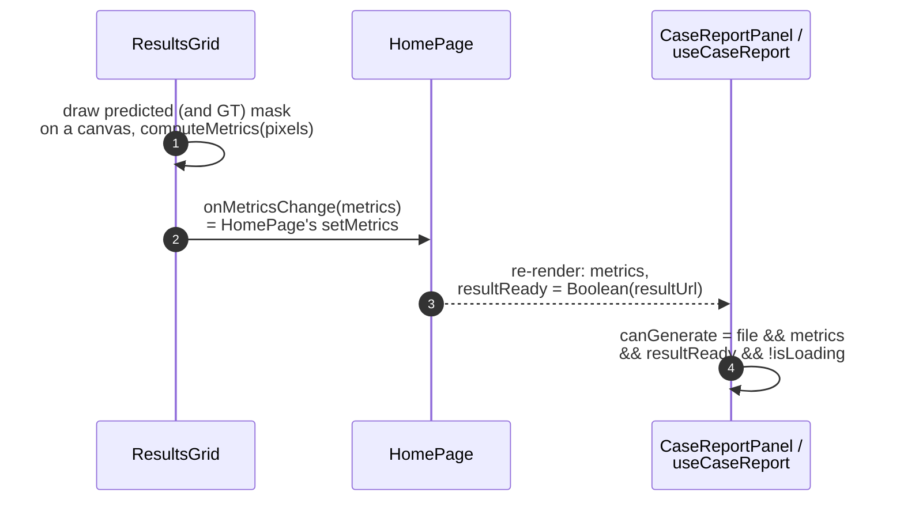
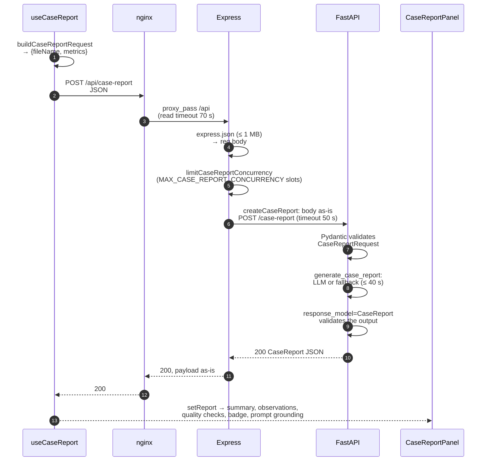

# Case-report request path

How segmentation metrics travel from the results grid to the LLM summary panel and back.
Picks up where `segment-request-path.md` ends: the mask is back and `metrics` exist.
What runs inside FastAPI once the request arrives is in `skinet-service-report-generation.md`.

## Phase 0: provider status (on page load)

`CaseReportPanel` mounts with the page, and `useProviderStatus` calls
`GET /api/case-report/status` once (no polling). The answer only drives the badge
next to the panel title ("LLM ready" / "LLM reachable" / "LLM unavailable"); it never
blocks report generation. If the call fails, the badge is simply hidden.

Path: nginx `/api` → Express (no concurrency limit, `STATUS_CHECK_TIMEOUT_MS` 12 s)
→ FastAPI `/case-report/status`, which always answers 200 with
`{llmConfigured, reachable, reason}`.

## Phase 1: metrics reach the panel (lifting state up)

`ResultsGrid` computes the metrics and `CaseReportPanel` sends them. They are siblings,
so neither can read the other's state. Their parent, `HomePage`, holds `metrics`
and passes:

- `setMetrics` down to `ResultsGrid` as the callback prop `onMetricsChange`;
- `metrics` down to `CaseReportPanel` as a plain prop.

- `predAreaPct` is always present. `dice`, `iou`, `sensitivity` and `specificity` are
  present only when a ground-truth mask (a `_lesion` file) was supplied.
- Metrics are computed in the browser. The server never receives the masks and
  cannot recompute or verify the numbers.
- `HomePage` resets `metrics` to `null` on a new file, on Analyse and on Reset.
  `useCaseReport` clears the previous report when the file or `resultReady` changes.

## Phase 2: generate

The user clicks **Generate LLM summary** → `useCaseReport.generateReport`.

A slow or broken LLM is **not** an error at this level. FastAPI still answers 200 with
a deterministic report and sets `reportMetadata.fallbackReason`; the panel shows a
"Fallback" badge and an explanation from `types/fallbackReason.ts`. The timeouts are
ordered so that Python's 40 s budget runs out before Express's 50 s and nginx's 70 s
(see "Timeouts" in the README).

## Where each check happens

| # | Layer | Checks | Rejects with |
|---|---|---|---|
| 1 | `useCaseReport.canGenerate` | file, metrics and result present; not already loading | button disabled, no request sent |
| 2 | nginx | whole request ≤ 11 MB | 413 (unreachable: the body is a few hundred bytes) |
| 3 | Express `express.json` | valid JSON, ≤ 1 MB | 500 (see Known gaps) |
| 4 | Express `limitCaseReportConcurrency` | at most `MAX_CASE_REPORT_CONCURRENCY` in flight (5 in `.env.config`) | 429 |
| 5 | FastAPI `CaseReportRequest` | `fileName` ≤ 180 chars; `predAreaPct` 0–100; other metrics 0–1 | 422 |
| 6 | FastAPI `response_model=CaseReport` | the report fits the response schema | 500 |

`MAX_CASE_REPORT_CONCURRENCY` also sizes the Python service's LLM connection pool,
which is why it has no default and must be set in `.env.config` (which generates `.env`).

## How errors get back to the user

- Express does **not** reshape case-report errors (unlike `/api/segment`): it forwards
  FastAPI's `{"detail": ...}` unchanged, and `useCaseReport` reads `error ?? detail`.
  A body that isn't JSON is replaced with `{"error": "Case report service error"}`.
- 429 (Express busy) → "Case report service is busy. Please retry shortly."
- 504 (Express's 50 s or nginx's 70 s) → "Case report request timed out."
- 503 (any Express-side failure other than a timeout, e.g. FastAPI unreachable)
  → "Case report service unavailable."
- 500 from FastAPI:
  - an exception inside `generate_case_report` → "Internal error during report generation";
  - a report that fails `response_model=CaseReport` (row 6) → "Case report service error".
    FastAPI validates the return value after `case_report` returns, outside its
    `try`/`except`, so it answers with plain-text "Internal Server Error", which
    Express replaces as above.
- `fetch` throws → "Could not reach the case report service…"

## Known gaps

- A FastAPI 422 has `detail` as an array of objects. `useCaseReport` uses it as the
  error message, so the user sees "[object Object]". Reachable from the UI with a
  file name over 180 characters.
- Express's error handler (`index.ts`) answers every error, including body-parser
  400/413s, with 500 "Internal server error". Not reachable from the UI, which always
  sends small, valid JSON.
- nginx's 413 page says "Image is too large" for any `/api` body, case-report
  included. Unreachable in practice (row 2).
