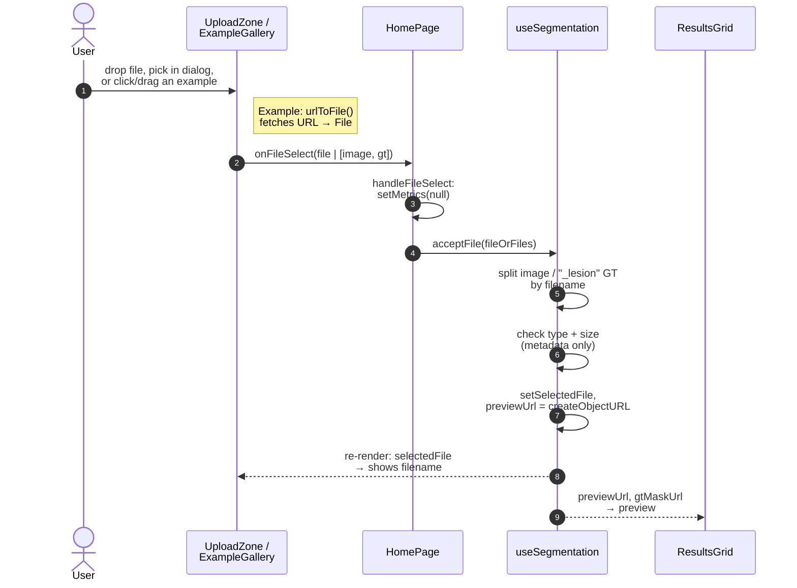
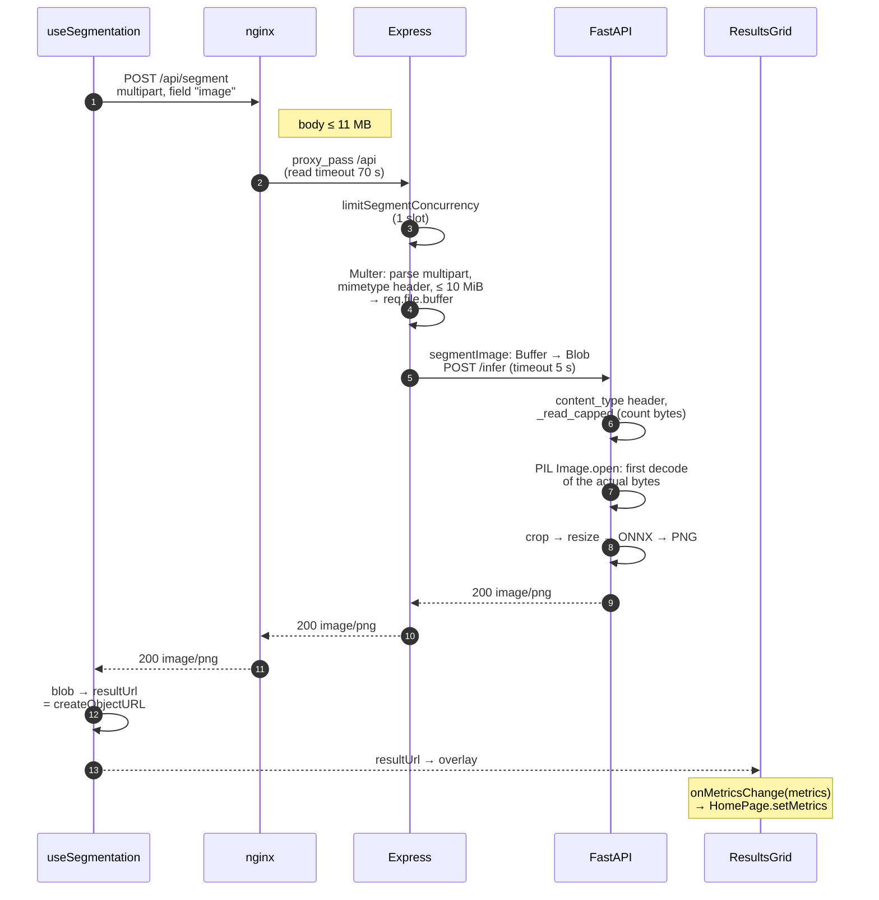

# Segmentation request path

How an image travels from the upload zone to the segmentation mask and back.
Companion to `case-report-request-path.md`, which picks up after `metrics` exist.

## Phase 1: select (browser only)

No application code reads the image bytes here. A `File` is a handle: name,
size and type are available at once; the bytes stay where they are.

## Phase 2: submit

The user clicks **Analyse** → `HomePage.handleSubmit` → `useSegmentation.onSubmit`.

## Where each check happens

| # | Layer | Checks | Looks at the actual bytes? | Rejects with |
|---|---|---|---|---|
| 1 | `useSegmentation.acceptFile` | MIME type (from extension), size | No | inline error, no request sent |
| 2 | nginx | whole request ≤ 11 MB | No (counts them) | 413, JSON via `@upload_too_large` |
| 3 | Express `limitSegmentConcurrency` | one segmentation at a time | n/a | 429 |
| 4 | Express Multer | `mimetype` header, file ≤ 10 MiB | No (counts them) | 400 / 413 |
| 5 | FastAPI `/infer` | `content_type` header | No | 400 |
| 6 | FastAPI `_read_capped` | bytes actually received ≤ cap | No (counts them) | 413 |
| 7 | FastAPI `preprocess` (PIL) | decodes as JPEG/PNG | **Yes** | 400 "Could not process the uploaded image" |

## How errors get back to the user

- FastAPI raises `HTTPException` → body `{"detail": ...}`.
- `segmentImage` maps `detail` → `{"error": ...}` and throws `UpstreamServiceError`
  with the same status; `sendServiceError` forwards both unchanged.
- Express-side timeout → 504 "Inference service timed out";
  connection failure → 503 "Inference service unavailable".
- `onSubmit` reads `error` from the JSON body and shows it. A 413 that isn't JSON
  (e.g. Cloudflare's HTML page) falls back to a generic "too large" message.
- A network failure (`fetch` throws) shows "Could not reach the server".

## Known gaps

- Dragging an example passes only `imageSrc` (`ExampleGallery.tsx:76`), so the GT
  mask is lost; clicking passes both.
- `useSegmentation.ts:59` says the server re-checks "the actual bytes". Express
  doesn't; only PIL (row 7) does.
